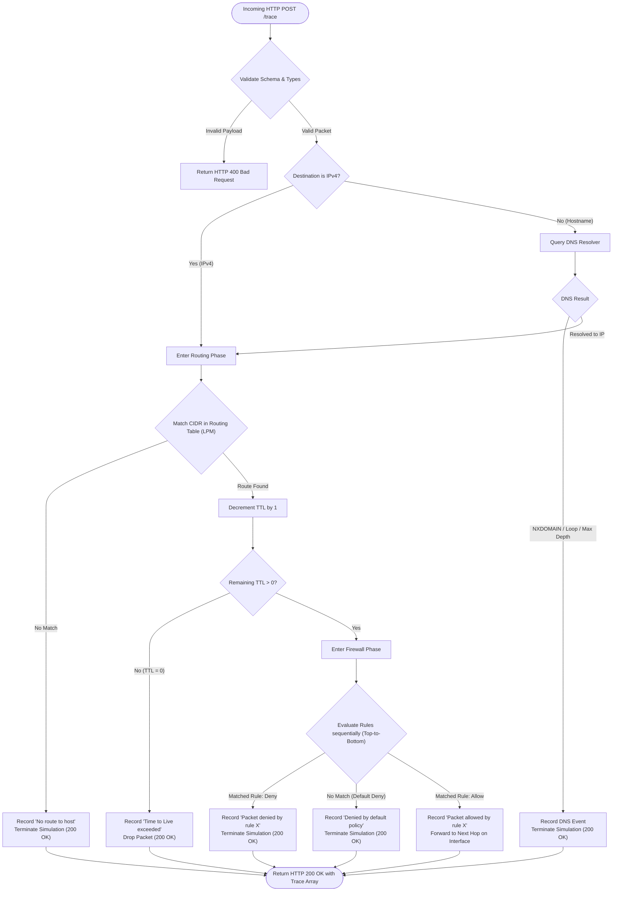

# Virtual Network Simulator for Packet Tracing

An API-driven virtual network simulator that models the end-to-end journey of network packets across Layer 3 (Network) and Layer 4 (Transport) network infrastructure. The engine performs recursive DNS resolution, strict algorithmic Longest Prefix Match (LPM) IP routing, hop-by-hop Time-To-Live (TTL) decrementing, and sequential stateless firewall evaluation, outputting an audit-ready, chronological trace of every packet decision.

---

## Table of Contents

1. [Project Overview](#project-overview)
2. [Key Capabilities & Implemented Functionality](#key-capabilities--implemented-functionality)
3. [Architecture & Component Responsibilities](#architecture--component-responsibilities)
4. [Packet Lifecycle Diagram](#packet-lifecycle-diagram)
5. [Project Directory Structure](#project-directory-structure)
6. [Prerequisites](#prerequisites)
7. [Environment Configuration](#environment-configuration)
8. [Configuration Schemas & Scenarios](#configuration-schemas--scenarios)
9. [Networking Mechanics](#networking-mechanics)
   - [DNS Resolution & CNAME Recursion](#dns-resolution--cname-recursion)
   - [Longest Prefix Match (LPM) Routing](#longest-prefix-match-lpm-routing)
   - [TTL Lifecycle Management](#ttl-lifecycle-management)
   - [Stateless Firewall & Default-Deny](#stateless-firewall--default-deny)
10. [API Reference & Endpoint Documentation](#api-reference--endpoint-documentation)
11. [Execution & Demonstration Evidence](#execution--demonstration-evidence)
12. [Docker & Containerized Setup](#docker--containerized-setup)
13. [Local Setup & Testing Guide](#local-setup--testing-guide)
14. [Troubleshooting & Limitations](#troubleshooting--limitations)

---

## Project Overview

In software engineering, distributed systems, and network reliability engineering, understanding how packets move through network hops, resolve across naming systems, and get filtered by access control lists is vital.

This simulator models the primary control and data plane decisions a network gateway performs when processing an incoming IP packet:
- Accepts packet definitions via a RESTful JSON API.
- Resolves domain names to IPv4 addresses using local DNS zone records.
- Identifies the most specific route entry from arbitrary CIDR blocks using bitwise Longest Prefix Match.
- Decrements the packet's TTL, discarding expired packets before forwarding.
- Enforces strict first-match firewall filtering with an implicit default-deny policy.
- Emits a step-by-step chronological audit trace detailing each decision.

---

## Key Capabilities & Implemented Functionality

- **Decoupled Architecture:** Core simulation modules (`DNSResolver`, `Router`, `Firewall`) are completely isolated from the HTTP transport layer (`Express.js`).
- **Strict Input Validation:** Utilizes Zod schemas with custom network validators to enforce valid IPv4 addresses, RFC 1123 hostnames, port boundaries (`1-65535`), allowed transport protocols (`TCP`, `UDP`), and positive integer TTLs.
- **Fail-Fast Configuration Loading:** Reads scenario configurations on startup from `CONFIG_PATH`. Gracefully rejects missing files, invalid JSON, or malformed CIDR prefixes prior to accepting traffic.
- **Algorithmic Longest Prefix Match:** Evaluates all configured CIDR routes and mathematically selects the longest subnet mask prefix (`/32` beats `/24` beats `/16` beats `/8` beats `/0`), independent of route configuration ordering.
- **CNAME Chain Resolution & Loop Defense:** Recursively resolves CNAME alias chains up to 5 hops with automatic loop detection preventing infinite recursion.
- **Stateless Firewall First-Match Evaluation:** Evaluates rules in sequential top-to-bottom order supporting exact and wildcard (`*`) ports and protocols, with fallback to an implicit default-deny rule.
- **Zero-Latency In-Memory Execution:** Scenario configuration is loaded once at boot and held immutably in memory, eliminating per-request synchronous filesystem I/O.
- **Comprehensive Automated Test Suite:** Over 70 unit and integration tests verifying all edge cases, boundary conditions, failure paths, and scenario configurations.

---

## Architecture & Component Responsibilities

The system is structured into five distinct layers:

1. **HTTP Routing & API Layer (`src/api/`, `src/app.js`):**
   - Parses HTTP payloads with size limits.
   - Enforces security best practices (disabled `x-powered-by`, strict JSON syntax error catching).
   - Exposes `POST /trace` and `GET /health` endpoints.
   - Translates validation exceptions into client-safe `400 Bad Request` responses without leaking stack traces.

2. **Simulation Orchestrator (`src/core/simulator.js`):**
   - Central coordinator managing the packet flow through DNS -> Router -> Firewall -> Forwarding.
   - Collects component events and guarantees monotonic 1-based step numbering.

3. **DNS Resolver (`src/components/dnsResolver.js`):**
   - Resolves hostnames via `A` and `CNAME` records.
   - Enforces depth limits (`MAX_CNAME_DEPTH = 5`) and circular reference detection.
   - Emits `NXDOMAIN` for unmapped domains.

4. **Routing Engine (`src/components/router.js`):**
   - Pre-indexes CIDR routes into bitwise network addresses and masks.
   - Performs Longest Prefix Match route selection.
   - Manages packet TTL decrement and drops expired packets (`remaining_ttl <= 0`).
   - Signals `No route to host` when unroutable.

5. **Firewall Engine (`src/components/firewall.js`):**
   - Evaluates access control lists against source CIDR, destination port, and protocol.
   - Applies first matching action (`allow` or `deny`).
   - Enforces default-deny when no rules match.

---

## Packet Lifecycle Diagram



---

## Project Directory Structure

```
packet-tracer-simulator/
├── config/
│   ├── scenario-basic/              # Basic network scenario
│   │   ├── dns.json                 # Standard A and CNAME mappings
│   │   ├── routes.json              # Subnet routes and 0.0.0.0/0 default route
│   │   └── firewall.json            # HTTP/HTTPS allow, SSH deny, default deny
│   └── scenario-complex/            # Advanced network scenario
│       ├── dns.json                 # Multi-level CNAME aliases
│       ├── routes.json              # Overlapping CIDRs (/32, /24, /16, /8), no default route
│       └── firewall.json            # Specific subnet allow/deny and wildcards
├── screenshots/                     # Verified execution evidence and demonstration artifacts
│   ├── 01_happy_path_success.json
│   ├── 02_dns_failure_nxdomain.json
│   ├── 03_routing_failure_no_route.json
│   ├── 04_ttl_expiration.json
│   ├── 05_firewall_denial.json
│   ├── 06_longest_prefix_match.json
│   ├── 07_multi_level_cname.json
│   ├── 08_firewall_default_deny.json
│   ├── demonstration_summary.json
│   └── DEMONSTRATION.md             # Complete cURL & trace evidence documentation
├── scripts/
│   └── demonstrate.js               # Automated demonstration runner
├── src/
│   ├── api/
│   │   └── routes.js                # Express API endpoint definitions
│   ├── components/
│   │   ├── dnsResolver.js           # DNS lookup, CNAME recursion, loop detection
│   │   ├── router.js                # Longest Prefix Match routing & TTL decrement
│   │   └── firewall.js              # First-match firewall & default-deny enforcement
│   ├── core/
│   │   ├── configLoader.js          # Startup scenario loader and JSON schema validator
│   │   ├── packetValidator.js       # Zod packet schema validation and normalization
│   │   └── simulator.js             # Packet lifecycle orchestrator
│   ├── utils/
│   │   ├── errors.js                # Domain-specific custom errors
│   │   └── ipUtils.js               # Bitwise IPv4 math, subnet masks, CIDR matcher
│   ├── app.js                       # Express app factory with error middlewares
│   └── server.js                    # Server startup and graceful termination
├── tests/
│   ├── helpers/
│   │   └── testClient.js            # In-memory test client for isolated environments
│   ├── integration/
│   │   └── api.test.js              # End-to-end API integration tests
│   └── unit/
│       ├── configLoader.test.js     # Config loader and fail-fast unit tests
│       ├── dnsResolver.test.js      # DNS recursion, loop, NXDOMAIN unit tests
│       ├── firewall.test.js         # Firewall rule ordering and wildcard unit tests
│       ├── ipUtils.test.js          # Bitwise math and CIDR membership unit tests
│       ├── packetValidator.test.js  # Packet schema validation unit tests
│       └── router.test.js           # LPM specificity and order-independence unit tests
├── .dockerignore                    # Docker build exclusion rules
├── .env.example                     # Environment template
├── .gitignore                       # Git ignore configuration
├── Dockerfile                       # Multi-stage production container definition
├── docker-compose.yml               # Docker Compose configuration
├── package.json                     # Project manifest and scripts
├── package-lock.json                # Locked dependency tree
└── README.md                        # Project documentation
```

---

## Prerequisites

- **Node.js:** v18.0.0 or higher (Tested on Node.js v22.18.0 LTS)
- **npm:** v9.0.0 or higher (Tested on npm v10.9.3)
- **Docker & Docker Compose:** Optional for containerized execution (Docker 20.10+ / Compose v2+)

---

## Environment Configuration

Configure environment variables via `.env` file or export them directly in your environment.

| Variable | Type | Default | Description |
|---|---|---|---|
| `PORT` | Number | `8080` | Port for the HTTP API server |
| `NODE_ENV` | String | `development` | Environment mode (`development`, `production`, `test`) |
| `CONFIG_PATH` | String | `config/scenario-basic` | Relative or absolute path to the active scenario directory |

An example file is provided at `.env.example`:
```bash
cp .env.example .env
```

---

## Configuration Schemas & Scenarios

Every scenario directory loaded via `CONFIG_PATH` must contain three JSON files.

### 1. `dns.json` Schema
A key-value dictionary mapping domain names to either an `A` record (IPv4) or `CNAME` record (alias domain).

```json
{
  "api.example.com": {
    "type": "A",
    "value": "10.0.1.50"
  },
  "www.example.com": {
    "type": "CNAME",
    "value": "api.example.com"
  }
}
```

### 2. `routes.json` Schema
An ordered array of routing table entries.

```json
[
  {
    "destination_cidr": "10.0.1.0/24",
    "next_hop": "192.168.1.1",
    "interface": "eth1"
  },
  {
    "destination_cidr": "0.0.0.0/0",
    "next_hop": "192.168.1.254",
    "interface": "eth0"
  }
]
```

### 3. `firewall.json` Schema
An ordered array of firewall filtering rules.

```json
[
  {
    "rule_id": 1,
    "action": "deny",
    "source_cidr": "0.0.0.0/0",
    "destination_port": 22,
    "protocol": "TCP"
  },
  {
    "rule_id": 2,
    "action": "allow",
    "source_cidr": "192.168.1.0/24",
    "destination_port": 443,
    "protocol": "TCP"
  }
]
```

### Available Pre-Configured Scenarios

1. **`scenario-basic` (`config/scenario-basic`):**
   - Standard corporate network with Web/API endpoints.
   - Includes default gateway `0.0.0.0/0` on `eth0` and local subnet `10.0.1.0/24` on `eth1`.
   - Firewall allows HTTP/HTTPS, explicitly blocks SSH (port 22), and default-denies unknown ports.

2. **`scenario-complex` (`config/scenario-complex`):**
   - Multi-tier enterprise topology with 3-tier CNAME aliases (`portal.corp.net` -> `app.corp.net` -> `origin.corp.net`).
   - Highly overlapping CIDR routes (`10.0.0.0/8`, `10.1.0.0/16`, `10.1.2.0/24`, `10.1.2.50/32`, `172.16.0.0/16`, `172.16.20.0/24`).
   - Deliberately omits `0.0.0.0/0` to test unroutable destinations (`No route to host`).
   - Advanced firewall rules combining host `/32` wildcards (`*`) with subnet-specific allow/deny ordering.

---

## Networking Mechanics

### DNS Resolution & CNAME Recursion
- If the packet destination is already an IPv4 address, DNS is bypassed entirely.
- For hostnames, the resolver queries the in-memory DNS dictionary.
- CNAME lookups recurse to their target hostname. The simulator maintains a recursion counter (`max 5`) and a visited set; circular alias loops (e.g., `A -> B -> A`) or deep chains are immediately intercepted and terminated with a clear failure trace.

### Longest Prefix Match (LPM) Routing
To simulate real router FIB (Forwarding Information Base) lookups, the router evaluates all configured routes against the destination IP:
1. Converts destination IP and route network IP to 32-bit unsigned integers.
2. Derives the 32-bit subnet mask: $\text{mask} = (0\text{xFFFFFFFF} \ll (32 - \text{prefix})) \ggg 0$.
3. Checks bitwise equality: $(\text{IP} \ \& \ \text{mask}) \equiv (\text{Network} \ \& \ \text{mask})$.
4. Sorts all matching entries by `prefixLength` in descending order.
5. Selects the highest prefix length. Order of definition in `routes.json` does not influence the mathematical outcome.

### TTL Lifecycle Management
- When a packet enters the router hop, its `initial_ttl` is decremented by 1.
- If the remaining TTL is greater than 0, routing proceeds to the firewall.
- If the remaining TTL reaches 0, the packet expires:
  - Event: `Time to Live exceeded. Packet dropped.`
  - The simulation halts immediately, skipping firewall evaluation and packet forwarding.

### Stateless Firewall & Default-Deny
- Rules are evaluated sequentially (top-to-bottom).
- For each rule, the packet's `source_ip`, `destination_port`, and `protocol` are inspected.
- Wildcards (`"*"`) for port and protocol match any incoming value.
- The **first matching rule** dictates the verdict (`allow` or `deny`), halting further rule evaluation.
- If the end of the rule list is reached without a match, the firewall applies an implicit **Default Deny** policy.

---

## API Reference & Endpoint Documentation

### 1. GET `/health`
Health check endpoint reporting runtime scenario and configuration metrics.

- **Status Code:** `200 OK`
- **Response:**
  ```json
  {
    "status": "healthy",
    "scenario": "scenario-basic",
    "routes_count": 3,
    "dns_records_count": 4,
    "firewall_rules_count": 4
  }
  ```

---

### 2. POST `/trace`
Simulates a packet traversal through the virtual network.

- **Request Headers:** `Content-Type: application/json`
- **Request Body Fields:**

| Field | Type | Required | Constraints |
|---|---|---|---|
| `source_ip` | String | Yes | Valid IPv4 address (e.g., `"192.168.1.100"`) |
| `destination` | String | Yes | Valid IPv4 address or RFC 1123 hostname |
| `destination_port` | Integer | Yes | Integer between `1` and `65535` |
| `protocol` | String | Yes | `"TCP"` or `"UDP"` (case-insensitive) |
| `initial_ttl` | Integer | Yes | Positive integer greater than `0` |

#### Example 1: Successful Trace (Happy Path)
```bash
curl -X POST http://localhost:8080/trace \
  -H "Content-Type: application/json" \
  -d '{
    "source_ip": "192.168.1.100",
    "destination": "api.example.com",
    "destination_port": 443,
    "protocol": "TCP",
    "initial_ttl": 5
  }'
```

**Response (`200 OK`):**
```json
{
  "trace": [
    {
      "step": 1,
      "component": "DNS",
      "action": "Resolved api.example.com to 10.0.1.50"
    },
    {
      "step": 2,
      "component": "Router",
      "action": "Route matched: 10.0.1.0/24 via 192.168.1.1 on eth1 (prefix /24). Decremented TTL to 4"
    },
    {
      "step": 3,
      "component": "Firewall",
      "action": "Packet allowed by rule 3 (source: 192.168.1.0/24, port: 443, protocol: TCP)"
    },
    {
      "step": 4,
      "component": "Router",
      "action": "Packet forwarded to next hop 192.168.1.1 via interface eth1"
    }
  ]
}
```

#### Example 2: Domain Not Found (`NXDOMAIN`)
```bash
curl -X POST http://localhost:8080/trace \
  -H "Content-Type: application/json" \
  -d '{
    "source_ip": "192.168.1.100",
    "destination": "unknown.example.com",
    "destination_port": 80,
    "protocol": "TCP",
    "initial_ttl": 5
  }'
```

**Response (`200 OK`):**
```json
{
  "trace": [
    {
      "step": 1,
      "component": "DNS",
      "action": "NXDOMAIN: Domain 'unknown.example.com' not found"
    }
  ]
}
```

#### Example 3: Routing Failure (No Route to Host)
*(Using `CONFIG_PATH=config/scenario-complex`)*
```bash
curl -X POST http://localhost:8080/trace \
  -H "Content-Type: application/json" \
  -d '{
    "source_ip": "10.0.0.1",
    "destination": "192.0.2.1",
    "destination_port": 80,
    "protocol": "TCP",
    "initial_ttl": 5
  }'
```

**Response (`200 OK`):**
```json
{
  "trace": [
    {
      "step": 1,
      "component": "Router",
      "action": "No route to host: destination 192.0.2.1 does not match any configured route"
    }
  ]
}
```

#### Example 4: TTL Expiration (`initial_ttl = 1`)
```bash
curl -X POST http://localhost:8080/trace \
  -H "Content-Type: application/json" \
  -d '{
    "source_ip": "192.168.1.100",
    "destination": "api.example.com",
    "destination_port": 443,
    "protocol": "TCP",
    "initial_ttl": 1
  }'
```

**Response (`200 OK`):**
```json
{
  "trace": [
    {
      "step": 1,
      "component": "DNS",
      "action": "Resolved api.example.com to 10.0.1.50"
    },
    {
      "step": 2,
      "component": "Router",
      "action": "Route matched: 10.0.1.0/24 via 192.168.1.1 on eth1 (prefix /24). Decremented TTL to 0"
    },
    {
      "step": 3,
      "component": "Router",
      "action": "Time to Live exceeded. Packet dropped."
    }
  ]
}
```

#### Example 5: Explicit Firewall Denial
```bash
curl -X POST http://localhost:8080/trace \
  -H "Content-Type: application/json" \
  -d '{
    "source_ip": "192.168.1.100",
    "destination": "api.example.com",
    "destination_port": 22,
    "protocol": "TCP",
    "initial_ttl": 5
  }'
```

**Response (`200 OK`):**
```json
{
  "trace": [
    {
      "step": 1,
      "component": "DNS",
      "action": "Resolved api.example.com to 10.0.1.50"
    },
    {
      "step": 2,
      "component": "Router",
      "action": "Route matched: 10.0.1.0/24 via 192.168.1.1 on eth1 (prefix /24). Decremented TTL to 4"
    },
    {
      "step": 3,
      "component": "Firewall",
      "action": "Packet denied by rule 1 (source: 0.0.0.0/0, port: 22, protocol: TCP)"
    }
  ]
}
```

#### Example 6: Validation Error (Missing Field / Bad Format)
```bash
curl -X POST http://localhost:8080/trace \
  -H "Content-Type: application/json" \
  -d '{
    "source_ip": "not-an-ip",
    "destination": "api.example.com"
  }'
```

**Response (`400 Bad Request`):**
```json
{
  "error": "Bad Request",
  "message": "Packet validation failed: source_ip: source_ip must be a valid IPv4 address (e.g. 192.168.1.1); destination_port: destination_port is required; protocol: protocol is required; initial_ttl: initial_ttl is required",
  "details": [
    {
      "field": "source_ip",
      "message": "source_ip must be a valid IPv4 address (e.g. 192.168.1.1)"
    },
    {
      "field": "destination_port",
      "message": "destination_port is required"
    },
    {
      "field": "protocol",
      "message": "protocol is required"
    },
    {
      "field": "initial_ttl",
      "message": "initial_ttl is required"
    }
  ]
}
```

---

## Execution & Demonstration Evidence

Verified demonstration artifacts are stored in [`screenshots/`](screenshots/):
- [`01_happy_path_success.json`](screenshots/01_happy_path_success.json): Happy path forwarding.
- [`02_dns_failure_nxdomain.json`](screenshots/02_dns_failure_nxdomain.json): NXDOMAIN halt.
- [`03_routing_failure_no_route.json`](screenshots/03_routing_failure_no_route.json): Unroutable network failure.
- [`04_ttl_expiration.json`](screenshots/04_ttl_expiration.json): Hop boundary TTL drop.
- [`05_firewall_denial.json`](screenshots/05_firewall_denial.json): Explicit firewall deny rule.
- [`06_longest_prefix_match.json`](screenshots/06_longest_prefix_match.json): LPM specificity (/32 over /24, /16, /8).
- [`07_multi_level_cname.json`](screenshots/07_multi_level_cname.json): 3-tier CNAME resolution.
- [`08_firewall_default_deny.json`](screenshots/08_firewall_default_deny.json): Default-deny security filter.
- [`DEMONSTRATION.md`](screenshots/DEMONSTRATION.md): Detailed curl invocations and step breakdowns.

To regenerate demonstration evidence at any time:
```bash
npm run demo
```

---

## Docker & Containerized Setup

### Build & Run with Docker Compose
The primary and recommended method for container execution:

```bash
docker compose up --build
```

The container starts with non-root security privileges (`USER node`), binds host port `8080`, and mounts the `./config` directory to `/app/config:ro`.

### Switching Scenarios in Docker
To launch the complex scenario, pass the `CONFIG_PATH` variable:

```bash
CONFIG_PATH=config/scenario-complex docker compose up --build
```
Or define `CONFIG_PATH=config/scenario-complex` inside `.env`.

### Stopping the Container
```bash
docker compose down
```

---

## Local Setup & Testing Guide

### 1. Install Dependencies
```bash
npm install
```

### 2. Run the Server Locally
To run with default scenario (`config/scenario-basic`):
```bash
npm start
```

To run with complex scenario:
```bash
# On Linux/macOS
CONFIG_PATH=config/scenario-complex npm start

# On Windows PowerShell
$env:CONFIG_PATH="config/scenario-complex"; npm start
```

### 3. Run Automated Tests
Execute the entire test suite (73 unit and integration tests):
```bash
npm test
```

Execute unit tests only:
```bash
npm run test:unit
```

Execute integration tests only:
```bash
npm run test:integration
```

---

## Troubleshooting & Limitations

- **Missing `CONFIG_PATH`:** If `CONFIG_PATH` is unset or points to a non-existent folder, the server intentionally exits on startup (`code 1`) with `FATAL: CONFIG_PATH environment variable missing`.
- **Malformed Scenario Files:** If any scenario file contains invalid JSON or schema violations (such as an invalid CIDR prefix like `/35`), the application reports the exact file and field and refuses to boot.
- **Single Hop Gateway Scope:** The simulator models processing at a single logical gateway router hop, accurately decrementing TTL and evaluating access controls. Inter-router BGP/OSPF dynamic peering loops are out of scope for this implementation.
